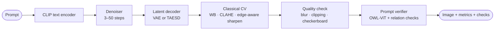
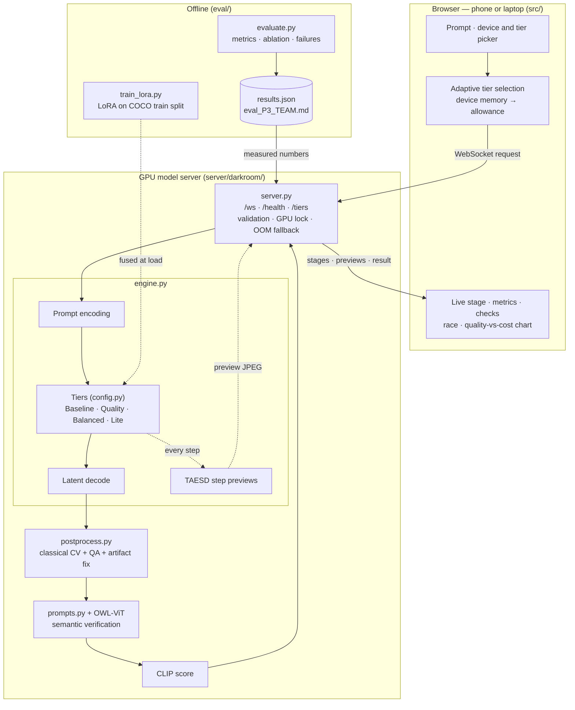
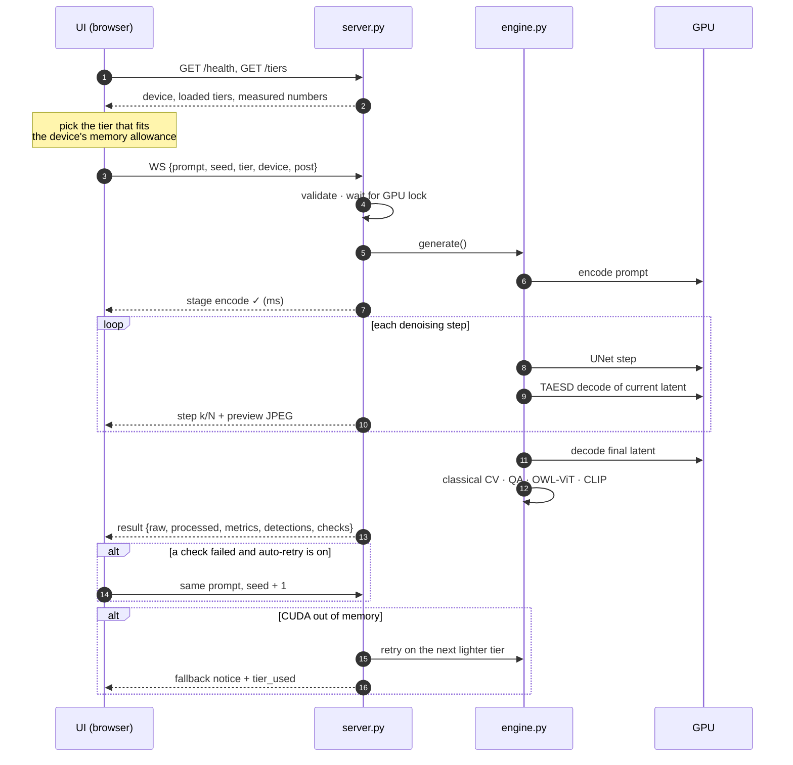
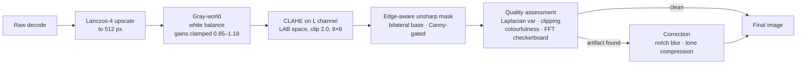
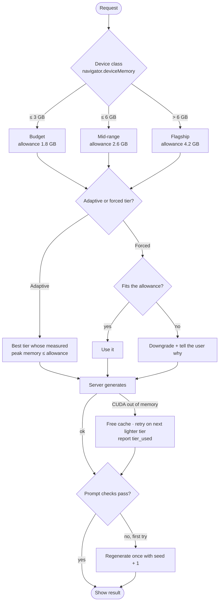
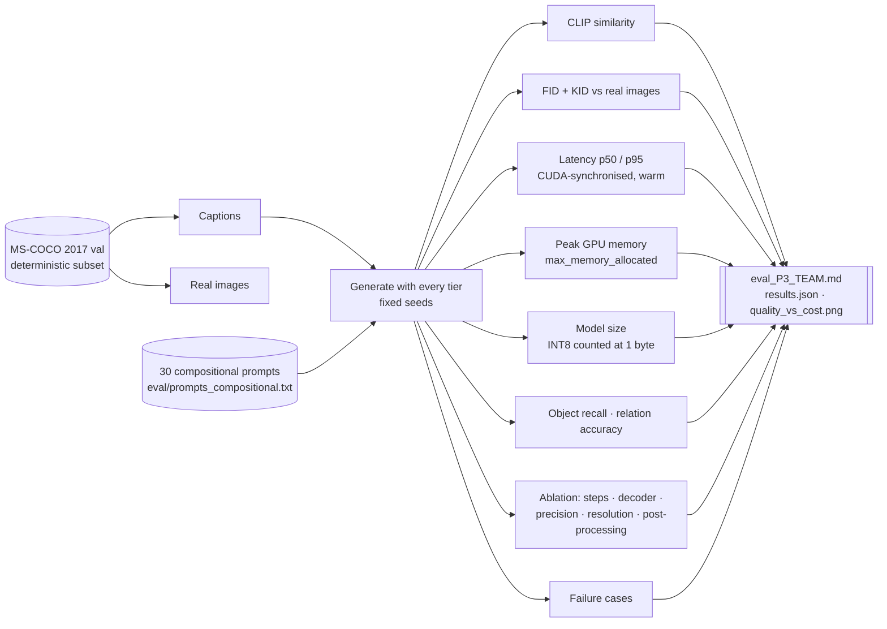
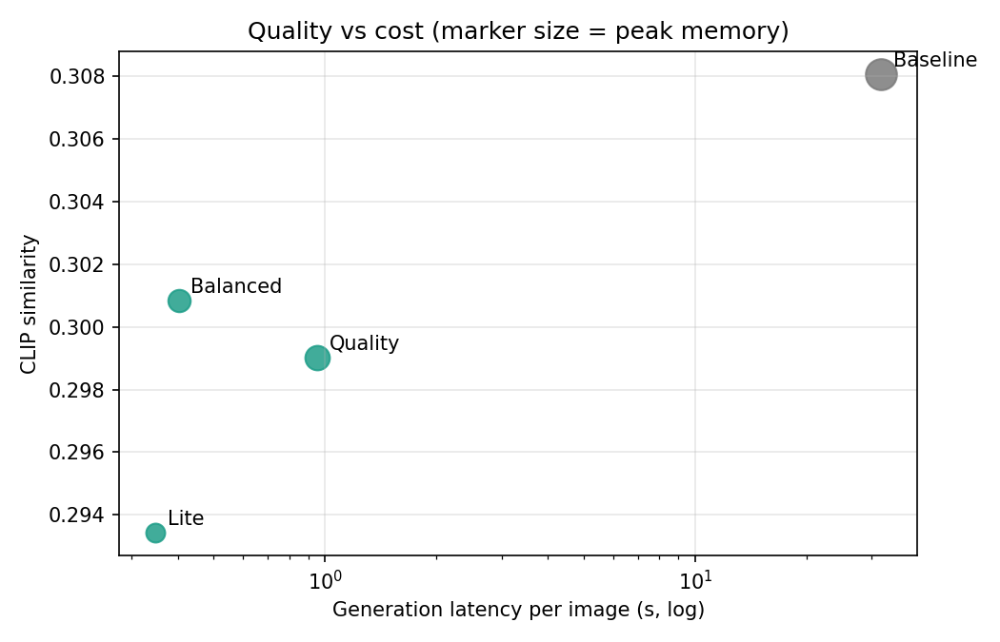
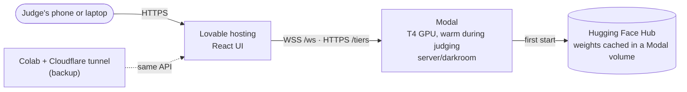

# Darkroom
### Resource-efficient text-to-image generation for mobile devices
**Computer Vision Hackathon 2026 · Problem Statement P3**

Darkroom turns a natural-language prompt into an image in a few denoising steps, sized to fit the memory budget of the phone it is generating for. It starts from Stable Diffusion 1.5 and applies five optimisations: consistency distillation, reduced precision, INT8 weight quantisation, a distilled latent decoder and resolution scaling. On a T4 these make generation **79× faster** (31.8 s → 0.40 s) while keeping 98% of the baseline's CLIP score, cut peak memory **4×** (5.1 GB → 1.28 GB) and shrink the model **3.8×** (4.27 GB → 1.11 GB). The measured numbers are in §10 and the evaluation report. A classical computer-vision stage corrects colour, contrast and artifacts. An open-vocabulary detector then checks that the image actually contains the objects, colours and spatial relations the prompt asked for.

| | |
|---|---|
| **Live application** | https://pixel-perfect-snapshot-8751.lovable.app (connects to the model server through `?server=wss://…/ws`; shows a labelled demo mode when no server is attached) |
| **Model server** | Runs on a GPU via the Colab notebook ("Optional A") with a Cloudflare tunnel; the notebook prints the judges' link |
| **Evaluation report** | [`eval/results/eval_P3_T03.md`](eval/results/eval_P3_T03.md) |
| **Design document** | [`docs/DESIGN.md`](docs/DESIGN.md) |
| **Architecture** | [§3 below](#3-system-architecture) and [`docs/ARCHITECTURE.md`](docs/ARCHITECTURE.md) |
| **Run everything on a free GPU** | [Open the notebook in Colab](https://colab.research.google.com/github/PrachiAgarwal-coder/prachi-darkroom/blob/main/notebooks/darkroom_colab.ipynb) |

---

## Contents
1. [Problem](#1-problem)
2. [Solution at a glance](#2-solution-at-a-glance)
3. [System architecture](#3-system-architecture)
4. [How a request flows](#4-how-a-request-flows)
5. [Model optimisation](#5-model-optimisation)
6. [Classical computer vision](#6-classical-computer-vision)
7. [Adaptive generation and fallback](#7-adaptive-generation-and-fallback)
8. [Semantic verification](#8-semantic-verification)
9. [Evaluation methodology](#9-evaluation-methodology)
10. [Results](#10-results)
11. [The application](#11-the-application)
12. [Repository guide](#12-repository-guide)
13. [Getting started](#13-getting-started)
14. [Deployment](#14-deployment)
15. [Reproducing the evaluation](#15-reproducing-the-evaluation)
16. [Development process](#16-development-process)
17. [Limitations and ethics](#17-limitations-and-ethics)
18. [Team](#18-team)

---

## 1. Problem

> How can a lightweight, high-quality text-to-image system generate semantically accurate, realistic images from natural-language prompts, while significantly reducing compute, memory and latency for resource-constrained mobile devices?

The reference model, Stable Diffusion 1.5, needs about 4.3 GB of FP32 weights. It runs 50 denoising steps with classifier-free guidance, which means two UNet passes per step. Both the memory and the compute are far beyond a mid-range phone. The challenge is to cut that cost without losing prompt alignment, visual quality or diversity, and to prove it with measurements, not by calling a hosted image API.

## 2. Solution at a glance

| Tier | Denoiser | Steps | Guidance | Precision | Decoder | Resolution | Target device |
|---|---|---|---|---|---|---|---|
| **Baseline** | SD 1.5 UNet | 50 | CFG 7.5 (2 passes/step) | FP32 | Full VAE | 512 | reference only |
| **Quality** | SD 1.5 + LCM-LoRA (fused) | 8 | none (1 pass/step) | FP16 | Full VAE | 512 | flagship |
| **Balanced** | SD 1.5 + LCM-LoRA (fused) | 4 | none | FP16 | TAESD | 512 | mid-range |
| **Lite** | SD 1.5 + LCM-LoRA (fused) | 3 | none | **INT8** UNet weights | TAESD | 384 → 512 | budget |

Every request also goes through classical post-processing, quality assessment, artifact correction and prompt verification.



## 3. System architecture



**Design decisions**
- **Two processes, one contract.** The React UI runs anywhere, including a phone browser. The Python server owns the GPU. They share a small JSON protocol (§4), so either side can be replaced on its own.
- **One loaded copy, many tiers.** Quality and Balanced share the same fused UNet and text encoder and differ only in steps and decoder. Lite adds an INT8 copy of the UNet. Switching tiers never reloads weights.
- **Measured, not claimed.** The UI shows numbers from `results.json` (produced by `evaluate.py`) as soon as they exist. Until then it says that its numbers are estimates.

## 4. How a request flows



**Message contract** (WebSocket, JSON)

| Direction | Message |
|---|---|
| UI → server | `{prompt, seed, tier, device:{ram_gb, allow_mb}, preview, post:{contrast, wb, sharp, upscale}}` |
| server → UI | `stage {stage, state, ms}` · `step {step, total, preview}` · `queued` · `fallback {from, message}` · `result {image, processed, metrics, qa, detections, checks, tier_used}` · `error {message, fallback_tier}` |

## 5. Model optimisation

The brief asks for at least two optimisation strategies. Darkroom uses five, and the ablation study (§9) isolates each one.

| # | Strategy | What we did | Why it saves cost |
|---|---|---|---|
| 1 | **Reduced sampling steps** | LCM-LoRA (latent consistency distillation), fused into the UNet: 50 → 8 / 4 / 3 steps | Fewer UNet evaluations; the UNet is about 90% of compute |
| 2 | **Knowledge distillation** | LCM-LoRA is a distilled student of SD 1.5; TAESD is a distilled VAE decoder | Removes classifier-free guidance (one UNet pass per step instead of two) and shrinks the decoder about 50× |
| 3 | **Reduced precision / quantisation** | FP32 → FP16 everywhere; Lite stores UNet weights in INT8 (optimum-quanto) | Halves, then quarters, weight memory and size on disk |
| 4 | **Latent-space optimisation** | Final and preview decoding through TAESD (~1M parameters) instead of the full VAE (~50M) | Decode time and memory drop sharply |
| 5 | **Resolution scaling** | Lite generates at 384 px (56% of the latent area of 512 px), then Lanczos upscaling + edge-aware sharpening | Attention cost grows quadratically with latent size |

**Meaningful adaptation.** `eval/train_lora.py` fine-tunes a LoRA (rank 16 on the attention projections) on a COCO training split that never overlaps the evaluation split, and reports validation loss during training. That LoRA is fused together with LCM-LoRA at load time. Its effect is measured as the change in CLIP and FID with and without it.

> **An honest note on INT8.** On a datacentre GPU, weight-only INT8 mainly saves **memory and disk**. Dequantisation can even make it slightly slower. On mobile NPUs with native INT8 kernels it is also faster. We report what we measured.

## 6. Classical computer vision

Implemented with OpenCV in [`server/darkroom/postprocess.py`](server/darkroom/postprocess.py). Every step can be switched off from the UI and is timed separately.



| Requirement (brief) | Implementation |
|---|---|
| Image resizing and resolution optimisation | Lanczos-4 upscaling from the tier's native resolution |
| Colour correction and enhancement | Gray-world white balance; CLAHE on luminance only, so hues are untouched |
| Edge-aware post-processing | Unsharp mask whose detail layer comes from a bilateral filter, applied only where a dilated Canny edge map is on, so flat regions don't gain noise |
| Image quality assessment | Laplacian variance (sharpness), % clipped pixels, Hasler–Süsstrunk colourfulness |
| Artifact detection and correction | FFT energy at the 8-px latent-grid frequency detects decoder checkerboarding and triggers a light Gaussian; more than 2% clipped pixels triggers tone compression |

## 7. Adaptive generation and fallback



There are three layers of resource awareness:
1. **Client-side budget:** the UI never asks for a tier the device cannot hold.
2. **Server-side out-of-memory recovery:** if the GPU still runs out, the server retries on the next lighter tier instead of failing.
3. **Semantic retry:** if the verifier finds a missing object or a wrong relation, the client retries once with a new seed.

## 8. Semantic verification

Complex prompts need more than a single CLIP score. [`prompts.py`](server/darkroom/prompts.py) parses each prompt into **objects with attributes** (for example *red cube*, *blue sphere*) and **spatial relations** (*left of, right of, on top of, above, below, in front of, behind, beside*). Each object becomes an OWL-ViT text query. Each relation is checked geometrically on the detected boxes.

```
"a red cube to the left of a blue sphere on a wooden table"
  objects   → red cube, blue sphere
  relations → (red cube) LEFT_OF (blue sphere)
  checks    → Found a red cube ✓ · Found a blue sphere ✓ · red cube is left of the blue sphere ✓
```

The evaluation turns these checks into three metrics: **object recall**, **relation accuracy**, and the share of **prompts fully satisfied**.

## 9. Evaluation methodology



| Metric (brief) | How it is measured |
|---|---|
| CLIP similarity | Cosine similarity between CLIP ViT-B/32 image and text embeddings, averaged over the COCO subset |
| FID (and KID) | torchmetrics Inception-v3 features, generated vs real COCO images. KID is reported too, because FID is biased at a few hundred samples |
| Generation latency | Encode + denoise + decode, after a warm-up call, with CUDA synchronised and previews off; mean, p50, p95 |
| Peak memory | `torch.cuda.max_memory_allocated()` per request |
| Model size | Bytes of UNet + text encoder + decoder weights (INT8 tensors counted at their real storage size) |
| Quality vs cost | Pareto plot of CLIP against latency, marker size = peak memory |

**Data splits.** The evaluation uses COCO val2017 images 0–299 of a fixed shuffle (seed 2026). LoRA training uses images 5000+ of the same shuffle, so the two never overlap.

**Ablation.** Each row changes exactly one factor:
- steps (1/2/4/8)
- decoder (VAE vs TAESD)
- precision (FP16 vs INT8)
- resolution (384 vs 512)
- post-processing (off vs on)

## 10. Results

Measured on a **Tesla T4** with `eval/evaluate.py` (fixed seeds, COCO val2017 captions). Full report: [`eval/results/eval_P3_T03.md`](eval/results/eval_P3_T03.md).

| Tier | Steps | CLIP ↑ | KID×1000 ↓ | Generation latency | Speed-up | Model size | Peak memory* | Prompts fully satisfied |
|---|---|---|---|---|---|---|---|---|
| Baseline (FP32, CFG) | 50 | **0.308** | **1.71** | 31.8 s | 1.0× | 4,265 MB | 5,111 MB | **0.37** |
| Quality | 8 | 0.299 | 12.18 | 0.95 s | **33×** | 2,132 MB | 2,810 MB (1.8× less) | 0.27 |
| Balanced | 4 | 0.301 | 7.61 | 0.40 s | **79×** | 1,970 MB | 2,168 MB (2.4× less) | 0.27 |
| Lite (INT8, 384 px) | 3 | 0.293 | 12.66 | 0.35 s | **91×** | **1,112 MB** | **1,276 MB (4.0× less)** | 0.23 |

\*Peak memory is measured per tier in isolation by `eval/measure_memory.py` (one process per tier, nothing else loaded).



**What the numbers say**
- **Speed:** Balanced generates in 0.40 s against 31.8 s for the baseline, **79× faster**, while keeping **98% of the baseline's CLIP score** (0.301 vs 0.308). Two effects multiply here: 50 → 4 steps, and no classifier-free guidance (one UNet pass per step instead of two).
- **Memory:** measured per tier in isolation, peak GPU memory falls from 5.1 GB (baseline) to 2.8 / 2.2 / **1.28 GB** for Quality / Balanced / Lite. Lite fits a budget phone's ~1.8 GB app budget, Balanced a mid-range phone's ~2.6 GB.
- **Size:** Lite's weights are **3.8× smaller** than the baseline's (1.11 GB vs 4.27 GB): FP32 → FP16 halves them, and INT8 weight quantisation of the UNet roughly halves the UNet again.
- **Where quality goes:** distribution-level quality (KID) is clearly worse for the few-step tiers than for the 50-step baseline. This is the known cost of consistency distillation. Balanced has the best KID of the optimised tiers, which is why it is the default for mid-range devices.
- **Spatial reasoning is the weak point for every tier:** relation accuracy is 0.19–0.31, even for the baseline. That is a limitation of SD 1.5's text conditioning, not something our optimisation introduced. It is the main motivation for the verifier and auto-retry.
- **FID caveat:** the baseline was scored on 50 images and the others on 100. FID is strongly sample-size dependent, so FID is not compared across tiers; KID is.

**Ablation highlights** (one factor changed at a time; full table in the report §8)

| Factor | Finding |
|---|---|
| Steps 1 → 2 → 4 → 8 | CLIP 0.277 → 0.293 → **0.297** → 0.293. It saturates at 4 steps, so 8 steps buys nothing measurable. This justifies Balanced = 4 steps |
| Full VAE → TAESD (4 steps) | Generation **577 → 400 ms (−31%)** at equal CLIP (0.297 vs 0.296) |
| FP16 → INT8 UNet | CLIP 0.296 → 0.294 (almost unchanged), **slower on T4** (400 → 537 ms) because of weight dequantisation; the benefit is size and memory, not speed, on GPUs without INT8 kernels |
| 512 → 384 px (Lite) | 416 → 351 ms (−16%) for a small CLIP drop (0.299 → 0.293) and softer detail (sharpness 3747 → 1510) |
| Post-processing off → on | Clipped pixels **1.31% → 0.05%**, sharpness 1333 → 3538, CLIP unchanged (0.297 vs 0.296); the OpenCV chain runs after generation and is timed separately in the app's pipeline view |

## 11. The application

The UI ([`src/routes/index.tsx`](src/routes/index.tsx)) is a single responsive page that works on phones and laptops:

| Area | What it shows |
|---|---|
| **Image stage** | The image forming from noise (one streamed preview per step); a raw-vs-processed slider; detection boxes with scores |
| **Compute budget** | Device class, memory allowance, adaptive or forced tier, downgrade notice, tier spec, post-processing toggles |
| **Live pipeline** | Each stage (encode, denoise, decode, post-process, quality check, verify) lighting up with its measured time |
| **Quality and cost** | CLIP similarity, latency with speed-up over the baseline, peak memory, model size, sharpness, clipped pixels |
| **Does it match the prompt?** | Every object and relation check, with auto-retry on failure |
| **The race** | The current tier vs the FP32 baseline on the same prompt and seed, timed by the server |
| **Quality vs cost** | Scatter of every tier: latency (log scale) against CLIP |
| **Demo mode** | With no server configured, a clearly labelled procedural demo, so the interface is always reviewable |

The model server also serves a lightweight fallback UI at `/` ([`server/static/index.html`](server/static/index.html)).

## 12. Repository guide

```
prachi-darkroom/
├── src/                          React UI (TanStack Start · Tailwind · Framer Motion · Recharts)
│   ├── routes/index.tsx          the whole application
│   └── lib/darkroom.ts           tier selection, server contract (normalizeTiers, runJob), demo renderer
├── server/                       Python model server
│   ├── darkroom/
│   │   ├── config.py             tier definitions and model IDs
│   │   ├── engine.py             model loading, generation, timing, memory, CLIP, verifier
│   │   ├── postprocess.py        classical computer vision
│   │   ├── prompts.py            prompt parser and relation checks
│   │   ├── server.py             FastAPI: /ws, /health, /tiers, fallback UI
│   │   └── mock.py               GPU-free stand-in for UI development and tests
│   ├── static/index.html         fallback UI
│   ├── tests/                    pytest suite (runs the real engine on a tiny random model)
│   └── requirements.txt
├── eval/
│   ├── download_coco.py          deterministic COCO subsets (eval and training splits)
│   ├── evaluate.py               full evaluation, ablation and failure cases
│   ├── train_lora.py             LoRA adaptation
│   ├── prompts_compositional.txt 30 multi-object prompts
│   └── results/                  evaluation output (committed)
├── notebooks/darkroom_colab.ipynb  one-click run on a free Colab GPU
├── deploy/
│   ├── modal_app.py              permanent GPU deployment
│   └── colab_backup.md           backup deployment with a public tunnel
├── docs/
│   ├── DESIGN.md                 design document
│   └── ARCHITECTURE.md           architecture details
├── Dockerfile                    one-command GPU server
└── README.md
```

**Files to open when presenting the code**

| To explain | Open |
|---|---|
| Tiers and optimisation choices | `server/darkroom/config.py` |
| Generation, timing, memory measurement, LCM-LoRA fusing, INT8 quantisation | `server/darkroom/engine.py` (`_load`, `generate`) |
| Classical CV | `server/darkroom/postprocess.py` |
| Prompt parsing and verification | `server/darkroom/prompts.py`, `engine.py` (`verify`) |
| Adaptive tier selection | `src/lib/darkroom.ts` (`resolveDevice`, `resolveTier`) |
| Live streaming in the UI | `src/lib/darkroom.ts` (`runJob`), `src/routes/index.tsx` (`beginGeneration`, `handleBackendMessage`) |
| Metrics, ablation, failure cases | `eval/evaluate.py` |

## 13. Getting started

### UI (any computer)
```bash
git clone https://github.com/PrachiAgarwal-coder/prachi-darkroom.git
cd prachi-darkroom
npm install          # or: bun install
npm run dev          # http://localhost:5173  (demo mode until a server is connected)
```
To connect a model server, either:
- click the connection pill in the header and paste `wss://<server>/ws`, or
- create `.env` from `.env.example`.

### Model server (NVIDIA GPU, 8 GB+; 16 GB to also load the FP32 baseline)
```bash
cd server
python -m venv .venv && source .venv/bin/activate        # Windows: .venv\Scripts\activate
pip install -r requirements.txt
uvicorn darkroom.server:app --host 0.0.0.0 --port 8000
```

| Variable | Default | Purpose |
|---|---|---|
| `DARKROOM_MOCK` | `0` | `1` = placeholder images, no GPU needed (UI development only) |
| `DARKROOM_BASELINE` | `1` on GPU | `0` skips the FP32 baseline to save about 4 GB |
| `DARKROOM_CUSTOM_LORA` | — | Path to a LoRA from `train_lora.py`, fused at load |
| `DARKROOM_WARMUP` | `1` | Warm every tier at start-up so the first request is fast |

### Docker (one command)
```bash
docker build -t darkroom . && docker run --gpus all -p 8000:8000 -v hf:/root/.cache/huggingface darkroom
```

### Tests
```bash
cd server && python -m pytest -q tests      # engine, parser, OpenCV chain — CPU only, no downloads
npm run test                                # UI
```

## 14. Deployment



**Model server on Modal:**
```bash
pip install modal
modal setup                         # once: log in
modal deploy deploy/modal_app.py    # from the repo root → prints https://<name>.modal.run
```
- **Cost control.** By default the server runs on a T4 and scales to zero when idle (first request after idle cold-starts in about 2–4 min). For the judging window, keep one GPU warm with `DARKROOM_WARM=1 modal deploy deploy/modal_app.py`, then redeploy without it afterwards. `DARKROOM_GPU=A10G` selects a faster GPU.
- **Backup:** the "Optional A" cells in the Colab notebook give a public URL in about 5 minutes.

**Free alternative: serve from an Apple-silicon Mac with a public tunnel.** The engine runs on Apple's GPU through PyTorch's MPS backend. A Cloudflare quick tunnel gives the laptop a public HTTPS URL while it stays awake:
```bash
cd server && source ../.venv/bin/activate && pip install -r requirements.txt
uvicorn darkroom.server:app --host 0.0.0.0 --port 8000          # wait for "Application startup complete"
# second terminal:
cloudflared tunnel --url http://localhost:8000                  # prints https://<random>.trycloudflare.com
```
- If the Lite tier errors on the Mac, restart the server with `DARKROOM_INT8=0` set.
- Recent PyTorch builds need **macOS 15 or newer** for Apple-GPU (MPS) inference. On macOS 14 the process aborts with `MPSNDArray arrayViewWithShape:strides: unrecognized selector`. Either update macOS or force CPU with `DARKROOM_DEVICE=cpu` (works, but expect tens of seconds per image).
- On non-CUDA devices peak GPU memory is not reported; the official memory numbers come from the CUDA evaluation run.

**Sharing a live server with any device.** Append the server to the app link and anyone who opens it is connected, with nothing to configure: `https://<app>.lovable.app/?server=wss://<server>/ws`. The Colab notebook's "Optional A" cell prints this link for you.

**UI on Lovable:**
1. Set the environment variable `VITE_DARKROOM_WS=wss://<name>.modal.run/ws`.
2. Publish.

## 15. Reproducing the evaluation

**Easiest:** [open the Colab notebook](https://colab.research.google.com/github/PrachiAgarwal-coder/prachi-darkroom/blob/main/notebooks/darkroom_colab.ipynb), set a T4 GPU, fill in the team cell, and run the cells top to bottom.

**From a terminal on any GPU machine:**
```bash
cd server
python ../eval/download_coco.py --n 300 --out ../data/coco
python ../eval/evaluate.py --team T01 --usns "USN1,USN2,USN3,USN4" --coco ../data/coco
#   quick pass: add  --n 100 --n-baseline 50 --n-ablation 20
```

| Output (in `eval/results/`) | Contents |
|---|---|
| `eval_P3_<TEAM>.md` | Submission file. Line 1 lists the USNs; then CLIP, FID/KID, latency, memory, size, quality vs cost, compositional accuracy, ablation, failure cases |
| `results.json` | Machine-readable numbers; the server's `/tiers` endpoint serves them to the UI |
| `quality_vs_cost.png` | Pareto plot |
| `failures/` | Images where verification failed |

**Optional LoRA adaptation:**
```bash
python ../eval/download_coco.py --n 1000 --offset 5000 --out ../data/coco_train
python ../eval/train_lora.py --data ../data/coco_train --steps 1500 --out ../lora/coco
DARKROOM_CUSTOM_LORA=../lora/coco python ../eval/evaluate.py --team T01 --usns "..." --out ../eval/results_lora
```

## 16. Development process

1. **Problem analysis.** We mapped every mandatory requirement and rubric line of P3 to a component before writing code. Two principles followed. Generation must come from our own optimised model, not a hosted API. Every reported number must come from the evaluation script.
2. **Model pipeline.** We chose SD 1.5 as the baseline because it is well documented and has mature distillation tools. We then layered LCM-LoRA, FP16, INT8, TAESD and resolution scaling as independent switches, so the ablation can isolate each.
3. **Classical CV and verification.** We wrote the OpenCV chain and the prompt parser plus detector checks as pure, unit-tested modules.
4. **Server.** We wrapped the engine in a FastAPI WebSocket server with a GPU lock, streamed previews, out-of-memory fallback and a mock mode for GPU-free development.
5. **Evaluation.** We built `evaluate.py` to produce the submission file, the ablation table and failure cases in one run, with fixed seeds and deterministic data splits.
6. **Interface.** We scaffolded the UI with Lovable. We then rewired it by hand to the real server contract, made the baseline race real, and fixed the phone layout and the build.
7. **Verification.** We ran the engine tests on a tiny random diffusion model, tested the full UI against the mock server in a headless browser at 1440 px and 390 px, and checked the build and the linter.

## 17. Limitations and ethics

**Limitations**
- Inference runs on a cloud GPU. The phone memory budget is simulated from measured peak memory, not run on a phone NPU.
- FID from a few hundred images is noisy and biased upward; we compare tiers against each other and report KID alongside.
- INT8 quantisation covers weights only (activations stay FP16), so GPU latency gains from INT8 are small.
- The verifier understands only the relation words listed in `prompts.py`, and OWL-ViT can miss small or stylised objects (false negatives).
- Typical failure modes: colour leakage between objects, swapped spatial relations, and wrong counts. See `docs/DESIGN.md` §9.

**Ethics and responsible use**
- SD 1.5 inherits LAION's biases (for example, stereotyped depictions of occupations and a Western default for everyday scenes). We did not mitigate them.
- The safety checker is disabled for latency. A public deployment should not be left open unattended.
- Generated images can be mistaken for photographs; the application labels its output as generated.
- Licences: SD 1.5 is under CreativeML Open RAIL-M; LCM-LoRA, TAESD, CLIP and OWL-ViT are under their own licences. COCO images are used for evaluation only.
- No API keys or secrets are needed or committed.

## 18. Team

| Name | USN | Responsibility |
|---|---|---|
| _name_ | 1RUA24CSE0305 | _part they owned_ |
| _name_ | 1RUA24CSE247 | _part they owned_ |
| _name_ | 1RUA24CSE0253 | _part they owned_ |
| _name_ | 1RUA24CSE0215 | _part they owned_ |
| _name_ | 1RUA24CSE280 | _part they owned_ |
