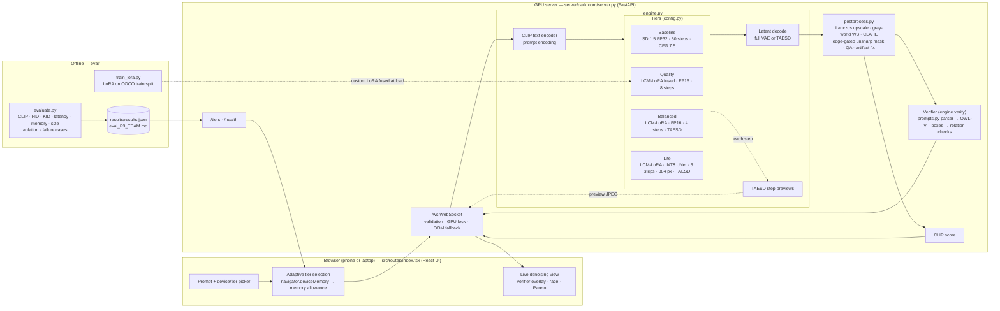

# System architecture

GitHub renders the diagram below. Every box names the file that implements it.

## Request lifecycle

1. The browser estimates the device class (`navigator.deviceMemory`, cores, user agent) and maps it to a memory allowance. **Adaptive** picks the best tier whose measured peak memory fits; a forced tier that does not fit is downgraded before sending (resource-aware fallback, client side).
2. The server validates the request, waits for the GPU lock (one image at a time), and runs the tier.
3. Each denoising step's latents are decoded by TAESD (~1M params) into a 256 px JPEG and streamed, so the image visibly forms.
4. The final latents are decoded by the tier's decoder, then the OpenCV chain runs (`postprocess.run`).
5. Quality assessment computes sharpness, clipping, colourfulness and an 8-px checkerboard score; detected artifacts are corrected.
6. The prompt is parsed into objects, attributes and relations; OWL-ViT finds each object; relations are checked geometrically.
7. If CUDA runs out of memory, the server retries on the next lighter tier and tells the client (resource-aware fallback, server side).
8. The client shows the result, the metrics and the checks; if a check failed it retries once with a new seed.
