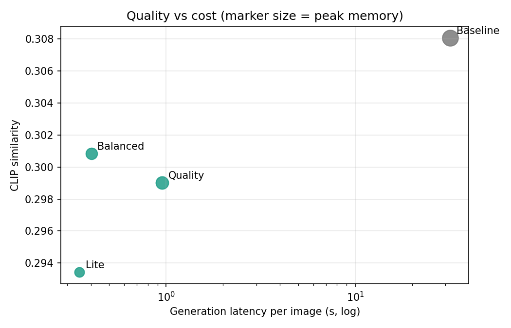
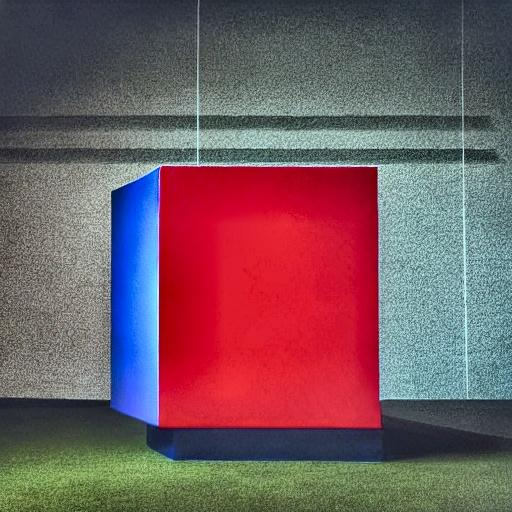
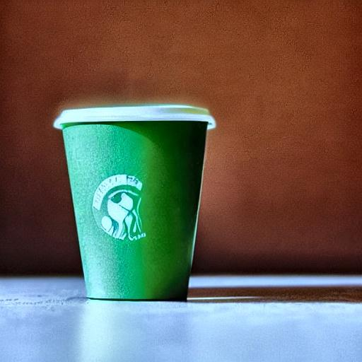
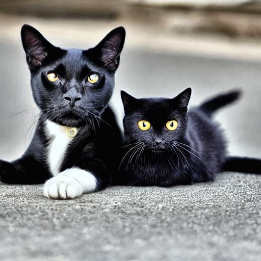
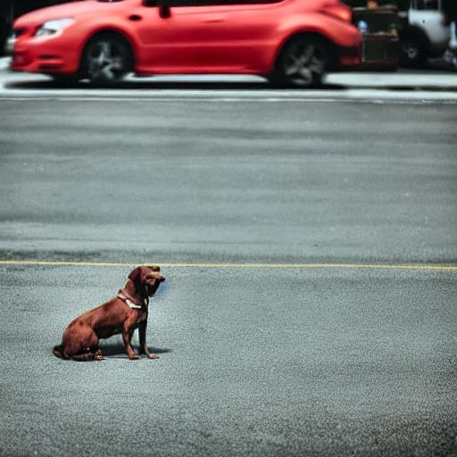
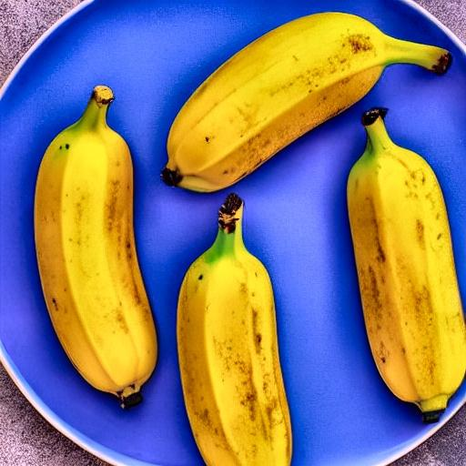
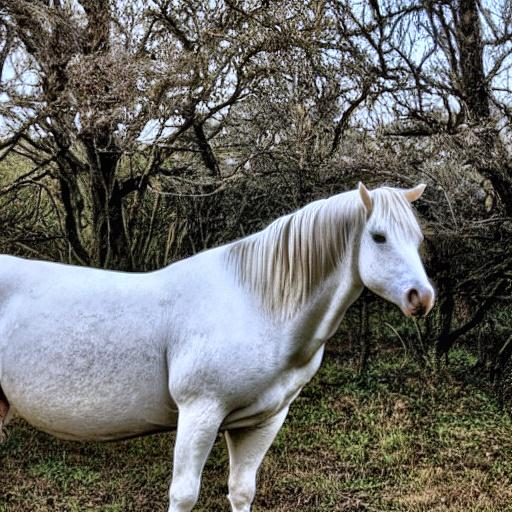

1RUA24CSE0305, 1RUA24CSE247, 1RUA24CSE0253, 1RUA24CSE0215, 1RUA24CSE280

# Evaluation — P3 Resource-Efficient Text-to-Image Generation — Team T03

Hardware: Tesla T4. Generated 2026-11-06 16:30. Seeds are fixed (0..N-1); COCO val2017 captions, deterministic subset.

## 1. CLIP similarity (text-image alignment)

| Tier | CLIP ↑ | Std | N |
|---|---|---|---|
| Baseline | 0.308 | 0.029 | 50 |
| Quality | 0.299 | 0.034 | 100 |
| Balanced | 0.301 | 0.032 | 100 |
| Lite | 0.293 | 0.033 | 100 |

## 2. FID and KID (distribution-level, vs real COCO images)

| Tier | FID ↓ | KID ×1000 ↓ |
|---|---|---|
| Baseline | 261.1 | 1.71 ± 0.00 |
| Quality | 213.3 | 12.18 ± 2.25 |
| Balanced | 212.0 | 7.61 ± 1.93 |
| Lite | 223.7 | 12.66 ± 2.68 |

_FID with a few hundred samples is biased upward; compare tiers against each other, not against published numbers. KID is unbiased at this sample size._

_**Tiers were evaluated on different numbers of images** (Baseline 50, Quality 100, Balanced 100, Lite 100). FID is strongly biased by sample count, so FID values are **not comparable across these rows**; use KID for cross-tier comparison._

## 3. Image generation latency

| Tier | Steps | Encode | Denoise | Decode | Generation mean | p50 | p95 | Speed-up |
|---|---|---|---|---|---|---|---|---|
| Baseline | 50 | 19 ms | 30838 ms | 958 ms | 31815 ms | 31927 ms | 31959 ms | 1.0× |
| Quality | 8 | 9 ms | 747 ms | 195 ms | 951 ms | 949 ms | 964 ms | 33.4× |
| Balanced | 4 | 10 ms | 371 ms | 21 ms | 402 ms | 401 ms | 412 ms | 79.1× |
| Lite | 3 | 10 ms | 326 ms | 13 ms | 348 ms | 336 ms | 414 ms | 91.4× |

## 4. Peak memory consumption

**Not yet isolated:** these peaks include every tier and the scorer models loaded in the same process. Run `eval/measure_memory.py` to replace them with per-tier measurements.

| Tier | Peak GPU memory | Reduction |
|---|---|---|
| Baseline | 8756 MB | 1.0× |
| Quality | 9438 MB | 0.9× |
| Balanced | 9299 MB | 0.9× |
| Lite | 9491 MB | 0.9× |

## 5. Model size

| Tier | Weights (UNet + text encoder + decoder) | Precision | Decoder |
|---|---|---|---|
| Baseline | 4265 MB | FP32 | Full VAE |
| Quality | 2132 MB | FP16 | Full VAE |
| Balanced | 1970 MB | FP16 | TAESD |
| Lite | 1112 MB | INT8 | TAESD |

## 6. Quality versus computational cost

| Tier | CLIP | FID | Latency | Peak memory | Size |
|---|---|---|---|---|---|
| Baseline | 0.308 | 261.1 | 31815 ms | 8756 MB | 4265 MB |
| Quality | 0.299 | 213.3 | 951 ms | 9438 MB | 2132 MB |
| Balanced | 0.301 | 212.0 | 402 ms | 9299 MB | 1970 MB |
| Lite | 0.293 | 223.7 | 348 ms | 9491 MB | 1112 MB |

## 7. Semantic consistency on compositional prompts

30 prompts with multiple objects, colour attributes and spatial relations, checked by an open-vocabulary detector (OWL-ViT).

| Tier | Object recall | Relation accuracy | Prompts fully satisfied |
|---|---|---|---|
| Baseline | 0.73 | 0.31 | 0.37 |
| Quality | 0.75 | 0.19 | 0.27 |
| Balanced | 0.72 | 0.19 | 0.27 |
| Lite | 0.60 | 0.19 | 0.23 |

## 8. Ablation study

Each row changes one factor; everything else is held fixed.

| Factor | Configuration | CLIP | Generation latency | Sharpness | Clipped px |
|---|---|---|---|---|---|
| Sampling steps | LCM 1 step | 0.277 | 295 ms | 5742 | 0.05 % |
| Sampling steps | LCM 2 steps | 0.293 | 389 ms | 4946 | 0.04 % |
| Sampling steps | LCM 4 steps | 0.297 | 575 ms | 3458 | 0.02 % |
| Sampling steps | LCM 8 steps | 0.293 | 957 ms | 3393 | 0.05 % |
| Decoder | Full VAE, 4 steps | 0.297 | 577 ms | 3458 | 0.02 % |
| Decoder | TAESD, 4 steps | 0.296 | 400 ms | 3538 | 0.05 % |
| Precision | FP16 UNet (TAESD, 4 steps, 512) | 0.296 | 400 ms | 3538 | 0.05 % |
| Precision | INT8 UNet (TAESD, 4 steps, 512) | 0.294 | 537 ms | 3578 | 0.05 % |
| Resolution | Lite at 384 px + upscale | 0.293 | 351 ms | 1510 | 0.12 % |
| Resolution | Lite at 512 px | 0.299 | 416 ms | 3747 | 0.05 % |
| Post-processing | Balanced, post-processing off | 0.297 | 404 ms | 1333 | 1.31 % |
| Post-processing | Balanced, post-processing on | 0.296 | 403 ms | 3538 | 0.05 % |

_Memory per configuration is reported in §4 (measured per tier in isolation)._

## 9. Failure cases

| Tier | Prompt | What failed | Type | Image |
|---|---|---|---|---|
| baseline | a blue sphere to the left of a red cube | Found a blue sphere; blue sphere is left of the red cube | missing object |  |
| baseline | a green cup on top of a brown book | Found a brown book; green cup is on top of the brown book | missing object |  |
| baseline | a black cat next to a white dog | Found a white dog; black cat is beside the white dog | missing object |  |
| baseline | two red apples beside a green bottle | Found a red apple; Found a green bottle; red apple is beside the green bottle | missing object |  |
| baseline | a yellow auto rickshaw in front of a white temple at night | Found a white temple; yellow auto rickshaw is in front of the white temple | missing object |  |
| baseline | a brown dog behind a red car | brown dog is behind the red car | wrong spatial relation |  |
| baseline | a white cat on top of a red chair | Found a red chair; white cat is on top of the red chair | missing object |  |
| baseline | a green tree to the left of a yellow house | green tree is left of the yellow house | wrong spatial relation |  |
| baseline | a blue mug to the right of a black laptop | Found a blue mug; Found a black laptop; blue mug is right of the black laptop | missing object |  |
| baseline | three yellow bananas on a blue plate | yellow banana is on top of the blue plate | wrong spatial relation |  |
| baseline | a white horse to the left of a brown cow | Found a brown cow; white horse is left of the brown cow | missing object |  |
| baseline | a blue bicycle next to a red fire hydrant | Found a blue bicycle; blue bicycle is beside the red fire hydrant | missing object |  |

_Write the cause of at least three of these failures in docs/DESIGN.md §Failure analysis._
